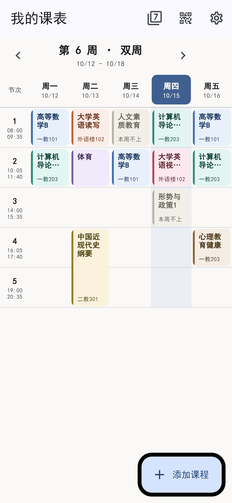
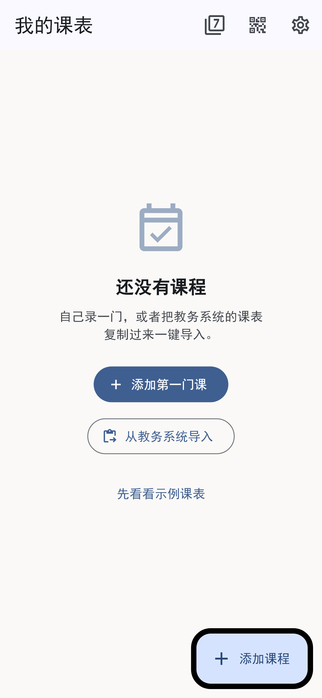
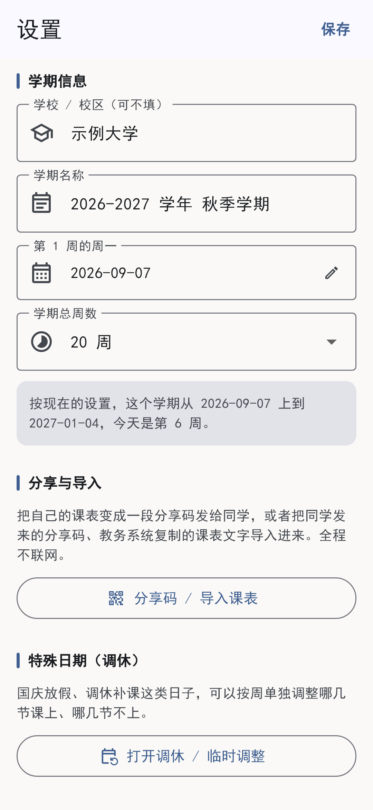

# 我的课表

一个**纯净、无广告、完全离线**的安卓课表 App。

没有开屏广告，没有会员，不用注册登录，**连网络权限都不申请**。
装上就能用，所有数据只留在你自己的手机里。

用 Flutter 写成，代码全部开源。

<p align="center">
  
  
  
  
</p>

---

## 它能做什么

**看课表**

- 一屏看一周，今天所在的那一列自动高亮
- 左右滑动或点箭头切换周次，一键跳回本周
- 周六周日可以收起来，也可以展开
- 每门课颜色固定不重复，一眼分得清

**算周次**（这是课表 App 最容易做错的地方，所以认真做了）

- 「单周上读写、双周上视听说」这类安排自动算好，不用你自己排两遍
- 连着两节同一门课自动合并成一张长卡片
- 这周不上的课显示成灰色幽灵卡，一眼看出「这周有、那周没有」
- 学期还没开学时，不会傻乎乎地算成第 1 周

**改课表**

- 加课、改课、删课，表单里有实时预览，保存前就知道它哪几周上
- **直接点课表里的空白格子**，星期和节次自动帮你填好
- 删错了可以「撤销」找回来
- 同一格撞课会先提醒，但单双周轮换不会被误判成冲突

**调休**

- 国庆这类假期，可以按周单独指定「哪几节不上」「哪节补上」
- 一整周都不上课的话，顶部一个按钮全部搞定

**分享给同学**

- 把自己的课表生成一个二维码（面对面直接扫）或一段分享码（复制发微信）
- 同学粘贴进来，先看预览，再决定是「合并」还是「整份替换」
- 全程不联网 —— 码本身就是数据，怎么传都行

**从教务系统导入**

- 把教务系统网页上的课表复制过来，粘进去自动识别
- 认得「周一 / 星期一」「第1-2节」「1-15周」「单周 / 双周」这些常见写法

---

## 关于隐私

这个 App **不申请 `INTERNET` 权限**。不是「不会联网」，是系统层面就不给它联网的能力。

课表存成手机私有目录里的一个 JSON 文件，别的 App 看不到，卸载 App 会一起删掉。

还有一件事值得说明：仓库里那份内置示例课表（`assets/data/sample_schedule.json`）里的
**学校、老师姓名、教室、课程代码全部是编的**，和任何真实学校或个人无关。

而且 App 首次打开**不会**加载它 —— 出厂就是一张干净的空表，等你来录。
想先看看效果，得自己在空课表页点「先看看示例课表」。

---

## 装上试试

### 方式一：直接下载

到 [Releases](../../releases) 下载最新的 `.apk`，传到手机上点开安装即可。
第一次装可能会提示「未知来源」，允许一下就行。

> 按 CPU 架构分开打的包在 15～19 MB（现在的手机基本都是 `arm64-v8a`，下这个就行）；
> 不分架构的通用包约 50 MB。不需要谷歌服务，安卓 5.0 以上都能装。

### 方式二：自己编译

需要先装好 [Flutter SDK](https://docs.flutter.dev/get-started/install)
（本项目用的是 stable 3.47.7 / Dart 3.13.5）和 Android SDK。

```bash
git clone <本仓库地址>
cd my_timetable

flutter pub get
flutter run                  # 插上手机直接跑
flutter build apk --release  # 出一个能分享给别人的安装包
```

打出来的包在 `build/app/outputs/flutter-apk/app-release.apk`。

### 关于安装包签名

仓库里**没有存放任何签名密钥**。直接 `flutter build apk --release` 打出来的包
会用 Flutter 自带的调试证书签名 —— 自己装、发给同学装都没问题，
但不能上架应用商店。

要正式发布的话，自己生成一个 keystore，在 `android/key.properties` 里配好
（`.gitignore` 已经把密钥文件排除掉，不会误传上去）：

```properties
storeFile=/绝对路径/my-release-key.jks
storePassword=你的密码
keyAlias=你的别名
keyPassword=你的密码
```

然后到 `android/app/build.gradle.kts` 里，把 `release` 的 `signingConfig`
换成你自己那份配置即可。

---

## 代码长什么样

```
lib/
├── main.dart                     入口：读本机存档 → 交给界面
│
├── models/                       数据模型（不认识界面，也不认识文件）
│   ├── course.dart               一门课：星期、节次、周次规则、调休
│   ├── semester.dart             学期：第 1 周从哪天开始、一共几周
│   └── class_period.dart         作息：第几节是几点到几点
│
├── logic/                        纯算法，可以脱离 Flutter 单独跑
│   ├── week_calculator.dart      核心：给定第几周，算出该显示哪些课
│   ├── grid_builder.dart         把课拼成网格块（连堂合并、幽灵卡）
│   ├── schedule_editor.dart      增删改、冲突检测
│   ├── schedule_parser.dart      把教务系统复制的文字解析成课
│   └── share_code.dart           分享码编解码
│
├── data/                         存取
│   ├── schedule_data.dart        一份完整课表
│   ├── schedule_store.dart       存取接口 + 仓库（决定「从哪儿读」）
│   ├── file_schedule_store.dart  存成手机里的 JSON 文件
│   └── sample_schedule.dart      内置示例课表
│
├── state/
│   └── schedule_controller.dart  改完自动存、自动通知界面重画
│
└── ui/                           界面
    ├── week_grid_page.dart       周课表网格（主角）
    ├── course_card.dart          课程卡片与详情弹窗
    ├── course_edit_page.dart     添加 / 编辑课程表单
    ├── settings_page.dart        设置（学期、作息、危险操作）
    ├── overrides_page.dart       调休
    ├── share_page.dart           分享与导入
    ├── course_palette.dart       配色分配
    └── ui_helpers.dart           日期与文字的小工具
```

分层是刻意的：`models/` 和 `logic/` 里没有一行
`import 'package:flutter/material.dart'`，
所以它们能在普通 Dart 里直接跑测试，速度飞快，也不容易被界面改动带崩。

---

## 几个设计选择

**为什么不用数据库？**

课表满打满算几十条数据，数据库的查询能力完全用不上，反而要背它的版本兼容包袱。
存成一个 JSON 文件更简单、更容易看懂，还正好和「分享给同学」是同一份东西 ——
分享码里装的就是它。

写入时先写临时文件、再改名覆盖，所以就算写到一半没电、被系统杀掉，
原来的课表也不会变成半截乱码。

**分享码为什么这么短？**

课表 → 精简字段的 JSON → **gzip 压缩** → Base64 → 加上 `KTB1:` 前缀。
实测一份 16 条安排、10 门课的整学期课表，原始 JSON 有 4106 个字符，
压完只剩 **936 个字符**，二维码才装得下。

分享码里**不带课程编号** —— 那是每台手机自己生成的，带过去会撞车。
导入时统一重新发号，所以同一份课表导入两次也不会变成双份。

**空课表为什么也自带作息？**

因为网格左边那一列要显示每节的起止时间，用户录课时也得从「第几节」里选。
出厂给一套通用的（上午 4 节 + 下午 4 节 + 晚上 2 节），
用户随时能在设置页里增删改。

**「今天是第几周」为什么用 floor 除法？**

```dart
weekOf = floor((今天 - 第1周周一) / 7) + 1
```

用 floor 而不是直接整除，开学前的日子才会算出 0 或负数，
而不是被硬塞进「第 1 周」。

---

## 测试

```bash
flutter test                     # 204 项自动化测试
dart run tool/verify_logic.dart  # 111 项数据与算法自检
```

覆盖了周次换算、单双周交替、连堂合并、冲突检测、分享码编解码、教务文本解析，
以及各个页面的真实渲染 —— Flutter 的布局溢出、控件没量出尺寸这类问题
在测试里会直接报错，能赶在装到手机之前发现。

---

## 还没做的

- **上课提醒** —— 需要通知权限和后台任务，暂时有意不做
- **桌面小组件** —— 要写安卓原生代码，各家系统限制也不少

## 许可

[MIT](LICENSE) —— 随便用、随便改，改好了欢迎提 PR。
